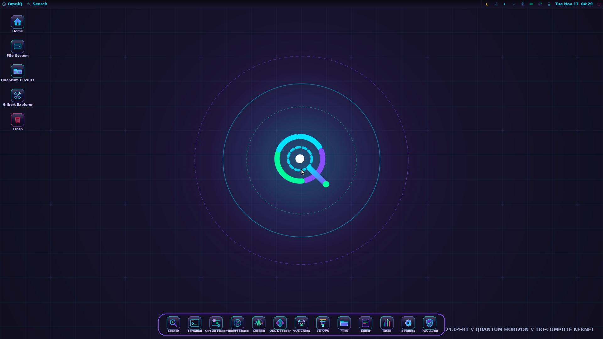
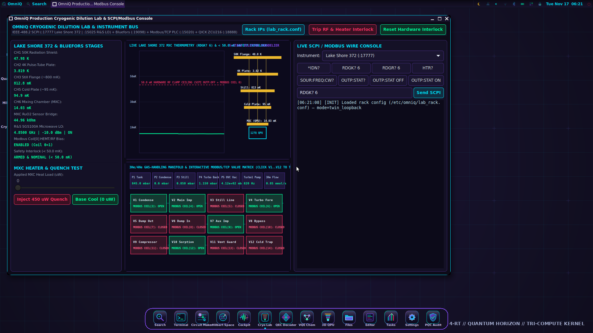

# OmniQ-OS: Real-Time Quantum Linux (`x86_64`)

<p align="center">
  
</p>

<p align="center">
  <strong>A Deterministic Hard Real-Time Operating System for Heterogeneous Tri-Compute (CPU + GPU + QPU), Hilbert-Space State Geometry & Visual Quantum Circuit Compilation</strong>
</p>

<p align="center">
  <a href="#architecture"></a>
  <a href="#tri-compute"></a>
  <a href="#qec-latency"></a>
  <a href="#pqc-security"></a>
  <a href="LICENSE"></a>
</p>

---

## 1. Vision & Overview

**OmniQ-OS** is an open-source, bootable `x86_64` Real-Time Quantum Linux distribution engineered to operate cryogenic Quantum Processing Units (QPUs) alongside classical CPUs and GPUs, paired with a native glassmorphic X11 desktop workstation (`Picom` + `JWM` + `OmniqDesktop`) and flagship quantum engineering studios:

* **The Decoherence Wall**: Physical superconducting transmons have phase coherence times ($T_2 \sim 50\text{--}150\,\mu\text{s}$). Cloud round-trips ($> 10\,\text{ms}$) make real-time syndrome feedback impossible.
* **Deterministic Kernel Scheduling**: Isolates RT QPU/QEC cores (`isolcpus=2,3 nohz_full=2,3 rcu_nocbs=2,3`) to prevent microwave pulse phase dephasing.
* **Spatial Quantum Memory Management (QMMU)**: Respects the **Quantum No-Cloning Theorem** via spatial qubit lattice partitioning, multi-hop BFS crosstalk guard bands, and `q-keepalived` CPMG/XY-8 dynamic decoupling.
* **Cryogenic Thermal Safety Interlock (`< 50.000 mK`)**: Hardware/kernel watchdog (`QPU_IOCTL_TRIP_INTERLOCK` / `QPU_IOCTL_SET_CRYO_TEMP`) clamps all RF DAC channels to `0x00` immediately if the dilution refrigerator mixing chamber exceeds `50.0 mK`.
* **100% Native Linux Stack**: C11 kernel accelerator driver (`omniq_qpu.ko`), POSIX C client library (`libomniq_qpu.so`), C++20 Core Engine & 7-Modality PQC Secret API (`omniq-core`, `omniq-secret-api`), C++17 X11/GLX OpenGL 3D Chandelier & Lattice Viewer (`omniq-qpu-3d`), and GTK3/Cairo + Tcl/Tk native desktop & quantum applications (zero web/JS mocks).

### Live Workstation Screenshots (`omniq-os-full.iso` in VirtualBox)

| Glassmorphic X11 Desktop & Dock | Hilbert Space Explorer (`F4`) |
| :---: | :---: |
|  |  |
| **Quantum Circuit Maker & IDE (`F6`)** | **5-Tier Quantum Cockpit (`F5`)** |
|  |  |
| **Cryogenic Dilution Lab & SCPI/Modbus Console (`F10`)** | |
|  | |

---

## 2. System Architecture

```
+---------------------------------------------------------------------------------------------------+
|                             OMNIQ-OS GLASSMORPHIC X11 DESKTOP (:0)                                |
|  Picom Dual-Kawase Blur + JWM Top Bar + Floating 13-App Dock + Spotlight (Alt+Space) + Control    |
|                                                                                                   |
|  +-------------------------+  +-------------------------+  +-----------------------------------+  |
|  | omniq-hilbert-space     |  | omniq-circuit-maker     |  | omniq-gui (5-Tier Cockpit)        |  |
|  | • 3D Q-Sphere (HSV)     |  | • Visual Gate Composer  |  | • PREEMPT_RT Jitter & WDT Clamp   |  |
|  | • Partial-Trace Bloch   |<=> • Time-Slice Scrubber   |  | • 127Q Heavy-Hex QMMU Lattice     |  |
|  | • Argand & rho Heatmap  |  | • OpenQASM 3 / Qiskit / |  | • RFSoC Scope & <50mK Cryo Guard  |  |
|  | • Ising exp(-iHt) & IPC |  |   Cirq / PennyLane Sync |  | • omniq-qec | vqe-chem | qpu-3d   |  |
|  +-------------------------+  +-------------------------+  +-----------------------------------+  |
+---------------------------------------------------------------------------------------------------+
|                         C++20 CORE ENGINE, DAEMONS & PYTHON SDK                                   |
|  • omniqd (:9090 HTTP + /dev/shm/omniq_qpu0 + /tmp/omniq_qpu0.sock)                               |
|  • omniq-secret-api (:9443 7-Modality 3,744B SHM + NIST FIPS 203/204 ML-KEM/DSA + Audit Chain)    |
|  • omniq-core / libomniq_core.so + libomniq_qpu.so + qpu-smi + omniq / omniqos Python SDK         |
+---------------------------------------------------------------------------------------------------+
|                     OMNIQ-OS REAL-TIME LINUX KERNEL (7.0.0-43 + omniq_qpu.ko)                     |
|  • /dev/accel/qpu0 & /sys/class/omniq_accel/accel!qpu0/                                           |
|  • QMMU Spatial Allocator + Multi-Hop Guard Bands + GPUDirect-QPU Zero-Copy DMA (< 600 ns)        |
|  • 3-State Auto-Detection (ONLINE_HARDWARE | OFFLINE_MAINTENANCE | SIMULATOR) + <50mK Interlock   |
+---------------------------------------------------------------------------------------------------+
```

---

## 3. Flagship Native Quantum & OS Suite

### 3.1 Interactive Hilbert Space Explorer (`bin/omniq-hilbert-space` — `F4`)
Dedicated multi-qubit quantum state geometry observatory for $|\psi\rangle \in \mathcal{H} = (\mathbb{C}^2)^{\otimes n}$ and mixed density operators $\rho$:
* **3D Interactive Q-Sphere / Bloch Hypersphere**: Mouse-orbitable 3D sphere grouping computational basis states $|x\rangle \in \{0,1\}^n$ onto Hamming-weight latitude rings with radial probability vectors $|c_x|^2$ and continuous HSV complex phase encoding $\arg(c_x) \in [-\pi, \pi]$.
* **Reduced Single-Qubit Bloch Sphere Array**: Computes exact partial traces $\rho_k = \mathrm{Tr}_{\neq k}(\rho)$ and renders individual 3D Bloch vectors $\vec{r}_k = (\langle X_k\rangle, \langle Y_k\rangle, \langle Z_k\rangle)$ with local purity $P_k = \mathrm{Tr}(\rho_k^2)$ (demonstrating $|\vec{r}_k|=0$ maximally mixed marginals inside globally pure Bell/GHZ states).
* **Complex Argand Phasor Disk & Basis Spectrum**: Real-vs-imaginary phasor plane alongside computational basis probabilities.
* **Density Matrix $\mathrm{Re}(\rho)$ / $\mathrm{Im}(\rho)$ Coherence Heatmap & Schmidt Decomposition**: Live bipartite Von Neumann entanglement entropy $S(\rho_A) = -\mathrm{Tr}(\rho_A \log_2 \rho_A)$, purity $\mathrm{Tr}(\rho^2)$, and Schmidt singular values $\lambda_i$.
* **Unitary & Open-System Dynamics**: Real-time Ising Hamiltonian evolution $U(t) = e^{-iHt}$, depolarizing noise ($p$), $T_1$ amplitude damping ($\gamma$), and live IPC sync (`/tmp/omniq_hilbert_state.json`) with the Quantum Circuit Maker.

### 3.2 Visual Quantum Circuit Maker & Multi-Framework IDE (`bin/omniq-circuit-maker` — `F6`)
* **Interactive Multi-Wire Cairo Composer**: Click-to-place 1Q/2Q/3Q gate palette (`H`, `X`, `Y`, `Z`, `S`, `T`, `SX`, `RX`, `RY`, `RZ`, `P`, `CNOT`, `CZ`, `SWAP`, `ISWAP`, `CP`, `CCX`, `CSWAP`, `RESET`, `MEASURE`) across `1..8` qubit wires with right-click deletion and 8 built-in circuit templates (Teleportation, Bell, GHZ, Grover, QFT, $\text{H}_2$ Singlet VQE, Bit-Flip QEC, Superdense Coding).
* **Time-Slice Statevector Scrubber**: Scrub column-by-column through intermediate circuit layers while inspecting live probability histograms and per-qubit Bloch vectors.
* **Bi-Directional OpenQASM 3.0 & Multi-SDK Transpiler**: Live editable OpenQASM 3.0 round-trip parser plus automatic **Qiskit**, **Cirq**, and **PennyLane** code synthesis and **RFSoC 5.0 GHz DRAG microwave pulse schedule** visualization.
* **Hardware QMMU Dispatch & 1-Click Hilbert Beam**: Allocates isolated partitions on `/dev/accel/qpu0` and beams the active quantum state directly into `omniq-hilbert-space`.

### 3.3 Production Cryogenic Dilution Lab & Wire-Protocol Instrument Bus (`bin/omniq-cryo-lab` — `F10`)
* **Real Lab Wire Protocols (`/etc/omniq/lab_rack.conf` + `omniq.lab`)**: Speaks authentic **IEEE-488.2 SCPI** over TCP/LXI, `/dev/usbtmc0`, and POSIX `termios` serial to **Lake Shore Model 372** AC Resistance Bridges (`RDGK?`, `RDGR?` $\text{RuO}_2$, `HTR?`, `RANGE 0,0`) and **Rohde & Schwarz SGS100A / Keysight** Microwave LOs (`SOUR:FREQ:CW`, `OUTP:STAT OFF`), **Bluefors Control Software HTTP REST** (`/values` 5-stage thermometry + `P1..P6` mbar), **RFC Binary MBAP Modbus/TCP** (`FC 0x01/0x03/0x05/0x06` vacuum valves `V1..V21` & HEMT RF bias coil `0`), and **Fermilab QICK `tProc` v2** (`430.08 MHz`, `418.5 ns < 500 ns` `condj` syndrome feedback + 16-bit signed DRAG Gaussian waveforms) for Xilinx Zynq UltraScale+ RFSoC ZCU216 (`/dev/xdma0_*` or JSON-RPC).
* **Hardware-in-the-Loop Rack Twin (`bin/omniq-lab-twin`)**: Coupled 5-stage cryogenic heat-capacity ODE daemon serving real SCPI (`:17777`, `:15025`), Bluefors HTTP (`:19098`), binary Modbus/TCP (`:15020`), and QICK RPC (`:18888`) out of the box — switchable to physical lab subnet IPs (`192.168.1.x`) in `/etc/omniq/lab_rack.conf` with zero code changes.

### 3.4 High-Scale C++20 Simulators, Real `ML-KEM-768` & Mission Control
* **1,024-Qubit C++20 CHP Clifford & AVX2/OpenMP Engine (`libomniq_core.so`, `omniq.stabilizer`)**: Simulates `127`-qubit GHZ in `0.58 ms`, `1,024`-qubit GHZ in `35 ms`, and 49-qubit `[[25,1,5]]` Surface Code QEC memory rounds in `6.0 ms`, alongside 20-qubit OpenMP + AVX2/FMA dense statevectors in `4.65 ms` and real `clock_nanosleep(TIMER_ABSTIME)` RT scheduling histograms (`bin/omniq-rt-bench` + `scripts/build_preempt_rt_kernel.sh`).
* **5-Tier Quantum Cockpit (`bin/omniq-gui` — `F5`)**: Hardware wakeup jitter monitor, 127-qubit Heavy-Hex QMMU spatial lattice, RFSoC I/Q scope, 5-stage dilution refrigerator `< 50.0 mK` safety interlock controls, and embedded RT console.
* **3D Dilution Chandelier & QPU Viewer (`bin/omniq-qpu-3d`)**: Compiled C++17 X11/GLX OpenGL 3D cryostat stages (`50K -> 4K -> Still -> Cold Plate -> 14 mK MXC`) and interactive 127Q lattice.
* **Surface Code QEC (`bin/omniq-qec` — `F9`) & VQE Chemistry (`bin/omniq-vqe-chem`)**: Interactive $[[d^2,1,d]]$ MWPM syndrome decoder + C++20 CHP tableau benchmark and $\text{H}_2 / \text{LiH} / \text{BeH}_2$ potential energy surface workbench ($< 1.6\,\text{mHa}$ chemical accuracy).
* **PQC & SOC 2 Security Auditor (`bin/omniq-pqc-audit`) + 7-Modality Secret API (`bin/omniq-secret-api`)**: Authenticated `:9443` daemon with real **NIST FIPS 203 `ML-KEM-768`** ($R_{3329}[X]/(X^{256}+1)$, OpenSSL SHAKE128/SHA3-256) lattice key encapsulation, 3,744-byte POSIX SHM, and SHA-256 hash-chained audit logs.
* **Complete Glassmorphic Desktop Suite**: `omniq-desktop-backdrop`, `omniq-spotlight` (`Alt+Space`), `omniq-app-launcher` (`F1`), `omniq-control-panel` (`F8`), `omniq-files` (`F3`), `omniq-settings` (`F7`), `omniq-tasks`, `omniq-edit`, `omniq-disks`, `omniq-ports`, `omniq-browser`, `omniq-wallpaper`, `omniq-screensaver`, `omniq-screenshot`, `omniq-power`, and `omniq-installer`.

---

## 4. Dual Bootable Hybrid `x86_64` ISOs

OmniQ-OS builds two standalone hybrid BIOS + UEFI bootable `x86_64` ISOs:

| Edition | Output File | Size | SHA-256 Checksum | Profile |
| :--- | :--- | :--- | :--- | :--- |
| **Full Live Quantum Workstation** | `omniq-os-full.iso` | `688 MB` | `6541f04804dbd8292abab09bb4a2848502e1c3d75ae5a9ed32fdef4c72344319` | Linux `7.0.0-43-generic` + `omniq_qpu.ko`, Zstd SquashFS + OverlayFS (`Live`, `toram`, `persistence`), Xorg + Mesa OpenGL, Picom + JWM desktop, Cryo Dilution Lab (`SCPI`/`Modbus`/`Bluefors`/`QICK`), 1,024Q Clifford & AVX2 Core, `ML-KEM-768`, Hilbert Space Explorer, Circuit Maker & OS suite |
| **Minimal Cryo-Rack Appliance** | `omniq-os.iso` | `22 MB` | `c5e1247bf29ff4de080e6877ab97bd0705d233b3d24cc0b2432dd36696570fc2` | Pure RAM `initramfs` (`src/init.c` static C PID 1 + BusyBox + `omniq_qpu.ko` + static `qpu-smi` HUD) for ultra-low-jitter cryogenic rack controllers |

---

## 5. Quick Start: Run Locally, Build ISOs & Boot in VirtualBox

```bash
# 1. Run full automated C UAPI, C++20, PQC Secret API, SDK & Desktop verification suite
./bin/omniq-test-suite --all

# 2. Launch native GUIs directly on your Linux host (starts omniqd :9090 + secret-api :9443)
./scripts/run_local.sh hilbert     # or: circuit | cockpit | all

# 3. Build Minimal Cryo-Rack ISO (omniq-os.iso) & Full Workstation ISO (omniq-os-full.iso)
./scripts/build_iso.sh
./scripts/build_full_distro_iso.sh

# 4. Provision & Boot VirtualBox VM "OmniQ-OS" (4 vCPUs, 4096 MB RAM, VMSVGA, NAT :19090/:19443)
./scripts/create_vmbox_omniq.sh start
```

---

## 6. Repository Layout

```
Omni-QOS/
├── bin/                        # 30+ native quantum & desktop executables (hilbert-space, circuit-maker, gui, qec, ...)
├── circuits/                   # Sample OpenQASM 2.0/3.0 circuits (Bell, GHZ, Grover, Teleportation, H2 VQE, Surface Code)
├── etc/                        # Full /etc hierarchy (omniq-system-init, X11/xinitrc, jwm, picom, gtk-3.0, icons, wallpapers)
├── kernel/
│   ├── drivers/accel/qpu/      # Loadable Linux kernel accelerator module (omniq_qpu.ko)
│   └── include/uapi/linux/     # Standardized POSIX ioctl UAPI (qpu.h)
├── lib/                        # Compiled shared libraries (libomniq_qpu.so, libomniq_core.so, libomniq_secret.so)
├── runtime/
│   ├── libomniq-qpu/           # POSIX C userland client library
│   └── python/                 # omniq & omniqos Python quantum SDK (statevector, density matrix, VQE, QEC, PQC)
├── scripts/                    # Dual ISO builders (build_iso.sh, build_full_distro_iso.sh), VMBox & asset generators
├── src/
│   ├── init.c                  # Minimal ISO static C PID 1 init
│   ├── core/                   # C++20 Quantum Core Engine & 7-Modality PQC Secret API
│   └── qpu_3d_viewer/          # C++17 X11/GLX OpenGL 3D Cryostat & 127Q Lattice Viewer
├── tools/qpu-smi/              # Native C QPU System Management Interface CLI & live HUD
└── tests/                      # C UAPI, C++20 Core, Hilbert/Circuit Maker, PQC Secret API & Desktop test suites
```

---

## 7. License

OmniQ-OS kernel subsystems (`kernel/`) are licensed under **GPLv2**. Userland libraries, C++20 engines, desktop shell components, quantum studios, and SDK runtimes are licensed under the **Apache License, Version 2.0**.
