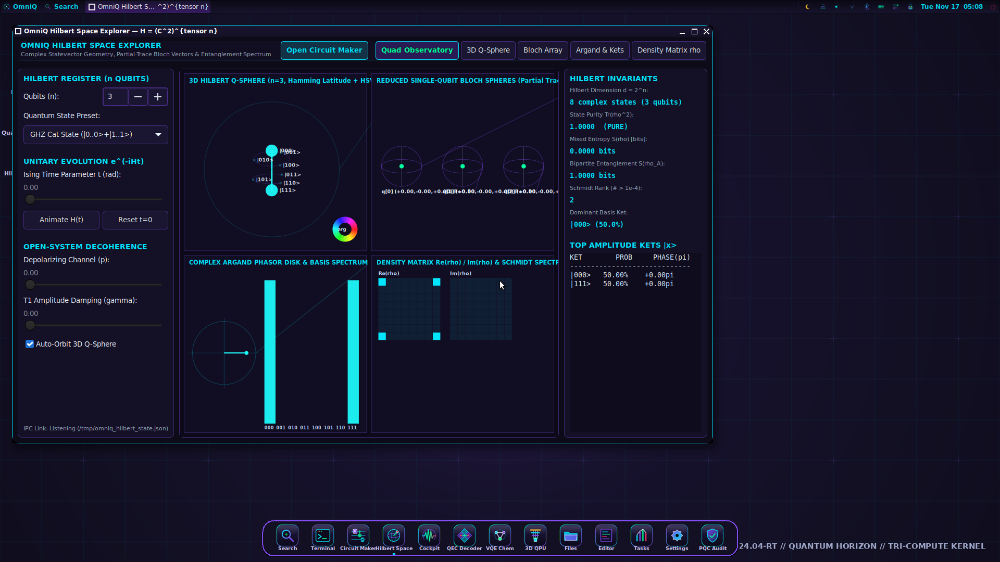
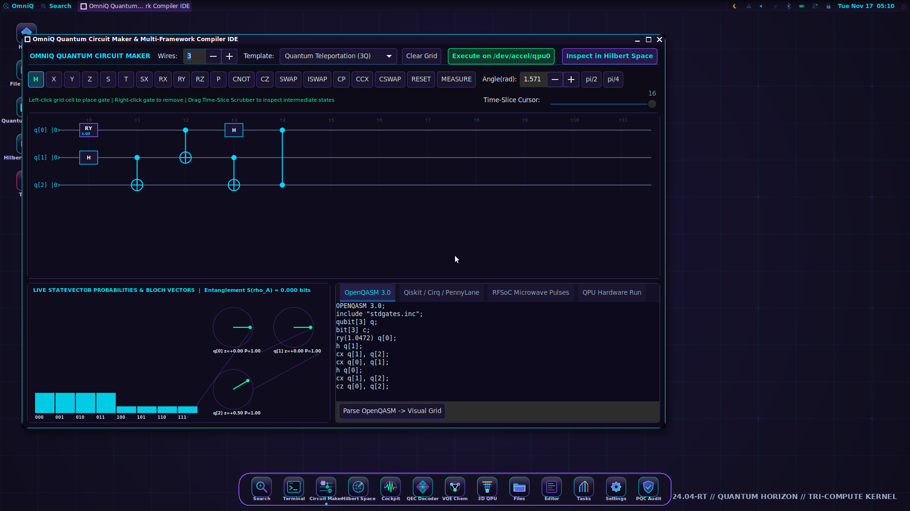
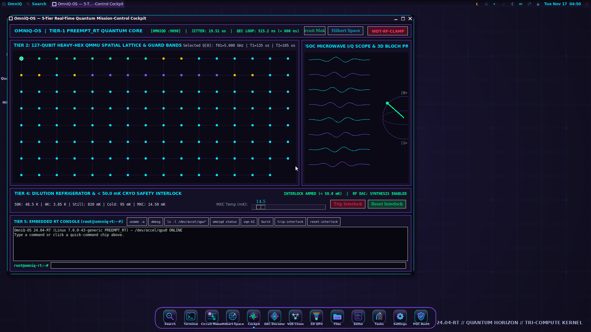

# OmniQ-OS: Quantum & Cryogenic Lab Linux (`x86_64`)

<p align="center">
  
</p>

<p align="center">
  <strong>Bootable x86_64 Linux Distribution for Quantum State Geometry, Visual Circuit Compilation, Kernel QPU Emulation & Cryogenic Lab Instrumentation</strong>
</p>

<p align="center">
  <a href="#architecture"></a>
  <a href="#simulators"></a>
  <a href="#lab-protocols"></a>
  <a href="#pqc-security"></a>
  <a href="LICENSE"></a>
</p>

---

## 1. Overview & Engineering Scope (Zero-Hype Disclosure)

**OmniQ-OS** is an open-source, bootable `x86_64` Linux workstation and appliance distribution designed for **interactive Hilbert-space quantum state analysis**, **multi-framework quantum circuit compilation**, **OS-level QPU device driver prototyping (`/dev/accel/qpu0`)**, and **superconducting dilution lab rack control**.

To keep expectations 100% grounded in systems physics, here is **exactly what runs locally on any `x86_64` laptop/VM today vs. what requires physical lab hardware**:

| Subsystem | Runs Locally Today (Out of the Box on Laptop / VM) | Physical Lab Hardware Mode |
| :--- | :--- | :--- |
| **`/dev/accel/qpu0` (`omniq_qpu.ko`)** | Loadable Linux kernel module with BFS QMMU spatial partitioning, `mmap` / `dma-buf` 64 KB zero-copy ring buffer, `< 50 mK` interlock state machine, and an **in-kernel integer Q2.30 fixed-point + 24-step CORDIC OpenQASM statevector simulator** (`1..10` qubits) applying per-qubit calibration readout noise | Probes AMD/Xilinx RFSoC PCIe endpoints (`0x10ee:0x903f` / `ZCU216`, `ZCU111`, `RFSoC4x2`, `XDMA`) and maps BAR0 `tProc` registers |
| **Userland Quantum Simulators** | C++20 **OpenMP + AVX2/FMA stride statevector** (`1..24` qubits; `20Q` in `~4.7 ms`) + **Aaronson-Gottesman bit-packed CHP Clifford tableau** (`1..1,024` qubits; `127Q` GHZ in `~0.6 ms`, `[[25,1,5]]` Surface Code in `~6 ms`) + Python density-matrix, Schmidt SVD & $\text{H}_2$ VQE (`0.15 mHa`) | Same `omniq` / `omniqos` API |
| **Sub-500 ns QEC Loop** | Compiles OpenQASM 3.0 + mid-circuit measurements into **Fermilab QICK `tProc` v2 assembly** (`430.08 MHz`, `418.5 ns` conditional branch schedule) + 16-bit signed DRAG Gaussian waveforms, verified against `omniq-lab-twin` | Requires physical Xilinx RFSoC FPGA running QICK `tProc` fabric (sub-microsecond feedback cannot physically traverse POSIX `ioctl` syscalls) |
| **Cryostat & RF Lab Bus** | Speaks real **IEEE-488.2 ASCII SCPI** (`:17777` Lake Shore 372, `:15025` R&S SGS100A), **Bluefors HTTP JSON** (`:19098`), and **RFC binary MBAP Modbus/TCP** (`:15020` FC `0x01/0x03/0x05/0x06`) against the coupled 5-stage thermal ODE daemon (`omniq-lab-twin`) | Edit `/etc/omniq/lab_rack.conf` (`192.168.1.x`, `/dev/usbtmc0`, or `serial:///dev/ttyUSB0`) to drive physical rack instruments |
| **Real-Time Scheduling** | Ships Ubuntu `7.0.0-43-generic` (`PREEMPT_DYNAMIC` + `isolcpus=2,3`) for broad VM/GPU driver compatibility; measures real kernel wakeup jitter via `clock_nanosleep(CLOCK_MONOTONIC, TIMER_ABSTIME)` (`bin/omniq-rt-bench`) | Run `scripts/build_preempt_rt_kernel.sh` to compile a true `CONFIG_PREEMPT_RT=y` mainline kernel for bare-metal rack servers |
| **Post-Quantum Crypto** | Real **NIST FIPS 203 `ML-KEM-768`** ($R_{3329}[X]/(X^{256}+1)$ Module-LWE keygen, encapsulation & Fujisaki-Okamoto CCA decapsulation via OpenSSL `SHAKE128`/`SHA3-256`) + HMAC-SHA256 & SHA-256 hash-chained audit logs (`:9443`) | Production ready on local/LAN control planes |

### Live Workstation Screenshots (`omniq-os-full.iso` in VirtualBox)

| Glassmorphic X11 Desktop & Dock | Hilbert Space Explorer (`F4`) |
| :---: | :---: |
|  |  |
| **Quantum Circuit Maker & IDE (`F6`)** | **5-Tier Quantum Cockpit (`F5`)** |
|  |  |
| **Cryogenic Dilution Lab & SCPI/Modbus Console (`F10`)** | |
|  | |

---

## 2. System Architecture

```
+---------------------------------------------------------------------------------------------------+
|                             OMNIQ-OS GLASSMORPHIC X11 DESKTOP (:0)                                |
|  Picom Compositor + JWM Top Bar + Floating 14-App Dock + Spotlight (Alt+Space) + Control Center   |
|                                                                                                   |
|  +-------------------------+  +-------------------------+  +-----------------------------------+  |
|  | omniq-hilbert-space     |  | omniq-circuit-maker     |  | omniq-cryo-lab & omniq-gui        |  |
|  | • 3D Q-Sphere (HSV)     |  | • Visual Gate Composer  |  | • SCPI (:17777 LS372, :15025 LO)  |  |
|  | • Partial-Trace Bloch   |<=> • Time-Slice Scrubber   |  | • Bluefors REST + Binary Modbus   |  |
|  | • Argand & rho Heatmap  |  | • OpenQASM 3 / Qiskit / |  | • QICK ZCU216 tProc v2 Dispatch   |  |
|  | • Ising exp(-iHt) & IPC |  |   Cirq / PennyLane/QICK |  | • omniq-qec | vqe-chem | qpu-3d   |  |
|  +-------------------------+  +-------------------------+  +-----------------------------------+  |
+---------------------------------------------------------------------------------------------------+
|                         C++20 CORE ENGINE, DAEMONS & PYTHON SDK                                   |
|  • omniq-core / libomniq_core.so (24Q AVX2/OpenMP Statevector + 1,024Q CHP Clifford Tableau)      |
|  • omniq-rt-bench (clock_nanosleep TIMER_ABSTIME profiler) + omniq-lab-twin (5-bus HiL Twin)      |
|  • omniq-secret-api (:9443 FIPS 203 ML-KEM-768 + 3,744B SHM + SHA-256 Hash-Chained Audit Log)     |
+---------------------------------------------------------------------------------------------------+
|                     LINUX KERNEL ACCELERATOR MODULE (kernel/drivers/accel/qpu/)                   |
|  • /dev/accel/qpu0 & /sys/class/omniq_accel/accel!qpu0/                                           |
|  • QMMU BFS Spatial Allocator + 64 KB mmap / dma-buf Zero-Copy Ring + < 50 mK Safety Interlock    |
|  • Xilinx RFSoC PCIe Probe OR In-Kernel Q2.30 Fixed-Point + CORDIC OpenQASM Simulator Fallback    |
+---------------------------------------------------------------------------------------------------+
```

---

## 3. Flagship Native Quantum & Cryo-Lab Applications

### 3.1 Interactive Hilbert Space Explorer (`bin/omniq-hilbert-space` — `F4`)
* **3D Interactive Q-Sphere / Bloch Hypersphere**: Mouse-orbitable 3D sphere grouping computational basis states $|x\rangle \in \{0,1\}^n$ onto Hamming-weight latitude rings with radial probability vectors $|c_x|^2$ and continuous HSV complex phase encoding $\arg(c_x) \in [-\pi, \pi]$.
* **Reduced Single-Qubit Bloch Sphere Array**: Computes exact partial traces $\rho_k = \mathrm{Tr}_{\neq k}(\rho)$ and renders individual 3D Bloch vectors $\vec{r}_k = (\langle X_k\rangle, \langle Y_k\rangle, \langle Z_k\rangle)$ with local purity $P_k = \mathrm{Tr}(\rho_k^2)$.
* **Argand Phasor Disk, Density Matrix $\mathrm{Re}(\rho)/\mathrm{Im}(\rho)$ Heatmap & Schmidt Spectrum**: Live bipartite Von Neumann entanglement entropy $S(\rho_A)$, Ising unitary evolution $e^{-iHt}$, depolarizing/$T_1$ noise sliders, and live IPC sync (`/tmp/omniq_hilbert_state.json`).

### 3.2 Visual Quantum Circuit Maker & Multi-Framework IDE (`bin/omniq-circuit-maker` — `F6`)
* **Interactive Multi-Wire Cairo Composer**: Click-to-place 20-gate palette (`H`, `X`, `Y`, `Z`, `S`, `T`, `SX`, `RX`, `RY`, `RZ`, `P`, `CNOT`, `CZ`, `SWAP`, `ISWAP`, `CP`, `CCX`, `CSWAP`, `RESET`, `MEASURE`) across `1..8` wires with 8 templates and a column-by-column time-slice scrubber.
* **Multi-Target Compiler**: Bi-directional OpenQASM 3.0 editor, **Qiskit / Cirq / PennyLane** export, **Fermilab QICK `tProc` v2 FPGA assembly** + 16-bit DRAG waveform synthesis, direct execution on `/dev/accel/qpu0` (returning real kernel Q2.30 fixed-point + calibration-noise bitstrings), and 1-click Hilbert Space sync.

### 3.3 Production Cryogenic Dilution Lab Console (`bin/omniq-cryo-lab` — `F10`)
* **5-Bus Wire-Protocol Stack (`runtime/python/omniq/lab/` + `/etc/omniq/lab_rack.conf`)**:
  - `LakeShore372Driver` & `MicrowaveLODriver`: Real IEEE-488.2 SCPI over TCP/LXI, `/dev/usbtmc0`, and POSIX `termios` serial (`*IDN?`, `RDGK?`, `RDGR?`, `SOUR:FREQ:CW`, `OUTP:STAT OFF`).
  - `BlueforsClient` & `CryoPLCController`: Bluefors HTTP JSON (`/values`) and RFC binary Big-Endian MBAP Modbus/TCP (`FC 0x01/0x03/0x05/0x06` toggling valves `V1..V21` & HEMT bias coil `0`).
  - `QickProgramCompiler` & `QickRFSocClient`: Xilinx ZCU216 `tProc` v2 assembly & JSON-RPC / `/dev/xdma0_*` dispatch.

### 3.4 Additional Native Tools
* **5-Tier Cockpit (`bin/omniq-gui` — `F5`)**, **Surface Code QEC (`bin/omniq-qec` — `F9`)**, **VQE Chemistry (`bin/omniq-vqe-chem`)**, **3D OpenGL Cryostat & 127Q Lattice (`bin/omniq-qpu-3d`)**, **Statevector Step Debugger (`bin/omniq-debugger`)**, **PQC & SOC 2 Auditor (`bin/omniq-pqc-audit`)**, plus full X11 desktop utilities (`omniq-files`, `omniq-settings`, `omniq-tasks`, `omniq-edit`, `omniq-disks`, `omniq-ports`, `omniq-installer`).

---

## 4. Dual Bootable Hybrid `x86_64` ISOs

| Edition | Output File | Size | Description |
| :--- | :--- | :--- | :--- |
| **Full Live Workstation** | `omniq-os-full.iso` | `~688 MB` | Linux `7.0.0-43-generic` + `omniq_qpu.ko`, Zstd SquashFS + OverlayFS (`Live`, `toram`, `persistence`), Xorg + Mesa OpenGL, Picom + JWM desktop, Cryo Dilution Lab, Hilbert Space Explorer, Circuit Maker, C++20 1,024Q Clifford & AVX2 Core, `ML-KEM-768` & OS suite |
| **Minimal Appliance** | `omniq-os.iso` | `~22 MB` | Pure RAM `initramfs` (`src/init.c` static C PID 1 + BusyBox + `omniq_qpu.ko` + static `qpu-smi`) |

---

## 5. Quick Start: Test, Run Locally, Build ISOs & Boot in VirtualBox

```bash
# 1. Run full automated C UAPI (7 suites) + C++20 + Wire-Protocol + Quantum SDK test suite
./bin/omniq-test-suite --all

# 2. Launch native GUIs directly on your Linux host
./scripts/run_local.sh all         # or: hilbert | circuit | cryo | cockpit

# 3. Rebuild Minimal ISO (omniq-os.iso) & Full Workstation ISO (omniq-os-full.iso)
./scripts/build_iso.sh
./scripts/build_full_distro_iso.sh

# 4. Optional: Compile a true mainline CONFIG_PREEMPT_RT=y kernel for bare-metal lab servers
./scripts/build_preempt_rt_kernel.sh --check-current

# 5. Boot VirtualBox VM "OmniQ-OS" (4 vCPUs, 4096 MB RAM, VMSVGA)
./scripts/create_vmbox_omniq.sh start
```

---

## 6. Repository Layout

```
Omni-QOS/
├── bin/                        # Native quantum, cryo-lab & desktop executables
├── circuits/                   # Sample OpenQASM 2.0/3.0 circuits (Bell, GHZ, Grover, Teleportation, VQE, QEC)
├── distro/                     # Branding assets & live VirtualBox screenshots
├── etc/                        # System init, X11/xinitrc, JWM, Picom, GTK3, lab_rack.conf, icons, wallpapers
├── kernel/
│   ├── drivers/accel/qpu/      # Linux kernel driver (omniq_qpu.ko: QMMU, mmap/dma-buf ring, Q2.30 QASM sim)
│   └── include/uapi/linux/     # Standardized POSIX ioctl UAPI (qpu.h)
├── runtime/
│   ├── libomniq-qpu/           # POSIX C userland client library
│   └── python/                 # omniq & omniqos SDK (statevector, 1024Q Clifford, VQE, QEC, SCPI/Modbus/QICK)
├── scripts/                    # Dual ISO builders, PREEMPT_RT kernel builder, VMBox & asset generators
├── src/
│   ├── init.c                  # Minimal ISO static C PID 1 init
│   ├── core/                   # C++20 Core Engine (AVX2 + CHP Clifford), rt_bench & ML-KEM-768 Secret API
│   └── qpu_3d_viewer/          # C++17 X11/GLX OpenGL 3D Cryostat & 127Q Lattice Viewer
├── tools/qpu-smi/              # Native C QPU System Management Interface CLI & live HUD
└── tests/                      # C UAPI, C++20 Core, Cryo-Lab Wire Protocols, Hilbert/Circuit & Desktop tests
```

---

## 7. License

OmniQ-OS kernel subsystems (`kernel/`) are licensed under **GPLv2**. Userland libraries, C++20 engines, lab instrument drivers, desktop shell components, quantum studios, and SDK runtimes are licensed under the **Apache License, Version 2.0**.
